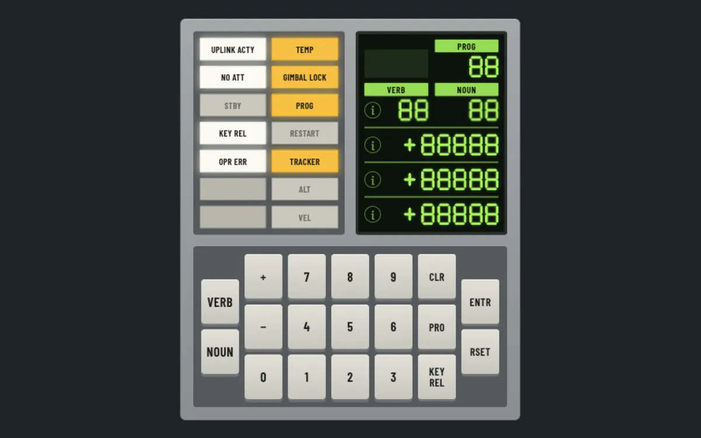

# pocket-agc

pocket-agc is a plan to run the real Apollo Guidance Computer (AGC) flight software on an old, rooted smartphone, with a native touchscreen DSKY and simulated spacecraft IO.



**Status:** Research and design; Phase 0 (desktop yaAGC + yaDSKY2 running Luminary099) is the first build milestone. There is no code in this repository yet.

Developed on a self-hosted GitLab; this GitHub repo is a read-only mirror.

## The idea

The phone runs the unmodified Apollo 11 flight software on a cycle-accurate AGC emulator. A native **DSKY** (Display and Keyboard), the console the astronauts used, sits on top, so you drive it the original way: by entering **Verb** and **Noun** codes. Underneath, the emulator's stand-in sensors and actuators are replaced step by step with simulated IO devices (IMU, radar, engines, RCS thrusters), and, as a stretch goal, a design for a USB IO board that could drive real hardware.

The project is documentation-first on purpose. The hard part is not writing code but understanding a 1960s real-time avionics computer well enough to host it faithfully.

## Why it is feasible

Most of the hard pieces already exist as open source, so the work is integration and IO fidelity rather than reinvention:

- **The flight software is public.** MIT's Apollo 11 source, `Comanche055` (Command Module) and `Luminary099` (Lunar Module), has been transcribed from the original listings. It is US government work.
- **A cycle-accurate emulator exists.** Ron Burkey's Virtual AGC project provides `yaAGC`, which runs the assembled original binaries, and `yaDSKY2`, a DSKY emulator. Both are GPL-licensed.
- **The IO model is documented.** The AGC talked to the spacecraft through numbered input/output channels and counter increments. `yaAGC` exposes exactly this over a socket protocol, which is the seam where the DSKY, simulated devices and any future hardware plug in.

## Architecture

Three layers joined by one boundary, the AGC's channel and counter IO:

- **Brain:** `yaAGC` running the original Luminary or Colossus binaries.
- **Face:** a native DSKY app that sends keycodes and receives display and lamp state. It contains no guidance logic.
- **World:** device processes that translate between physics quantities and AGC pulses or bits. Software models with a minimal spacecraft physics model first (Phase 2), then a conceptual USB IO board (Phase 3) that implements the same contract.

Keeping that boundary pure is the main design rule: neither the UI nor a device may bypass the physics or the guidance software. Details in [docs/02-architecture.md](docs/02-architecture.md).

## Roadmap

| Phase | Goal | Demo |
|---|---|---|
| 0. Vision and research (in progress) | Docs done; build `yaAGC` and `yaDSKY2` on a desktop and run `Luminary099` | Real Luminary software on a laptop, driven from the keyboard |
| 1. Runs on the phone | `yaAGC` on the phone's Linux userland plus a native DSKY over the local socket | Verb/Noun entry on a touchscreen DSKY |
| 2. Simulated spacecraft | PIPA, IMU/CDU, RCS, descent engine and landing radar models; fly P63/P64 | A simulated powered descent, including a 1201/1202 alarm and recovery |
| 3. Hardware bridge (stretch) | Specify a USB IO board that is a drop-in replacement for the Phase 2 models | Schematic, and optionally one real sensor driving an AGC counter |

Task-level checklist in [docs/roadmap.md](docs/roadmap.md).

## Documents

```
docs/
  00-vision.md         Goals, non-goals, definition of done.
  01-agc-primer.md     How the AGC worked: DSKY, channels, counters, the executive.
  02-architecture.md   Phone host, AGC core, DSKY UI, device layer, future IO board.
  03-io-devices.md     Every IO device the AGC used and what simulating it needs.
  04-prior-art.md      Virtual AGC, the MIT source, licensing: what is reused vs. built.
  roadmap.md           Phase 0 to 3 milestones.
research/              Working notes and reference tables.
```

## Build and test

Nothing to build yet. Phase 0's first build step is compiling `yaAGC` and `yaDSKY2` from the Virtual AGC project on a desktop; this repository's own code, tests and CI start with Phase 1.

## License

This repository's original content (documentation, and future original code) is under the MIT License; see [LICENSE](LICENSE). It does not cover reused components: the Apollo flight software is US government work in the public domain, and Virtual AGC components such as `yaAGC` and `yaDSKY2` are GPL-licensed by their authors. See [NOTICE.md](NOTICE.md). A build that links against `yaAGC` will likely need a GPL-compatible license; that decision is tracked in [docs/04-prior-art.md](docs/04-prior-art.md).
